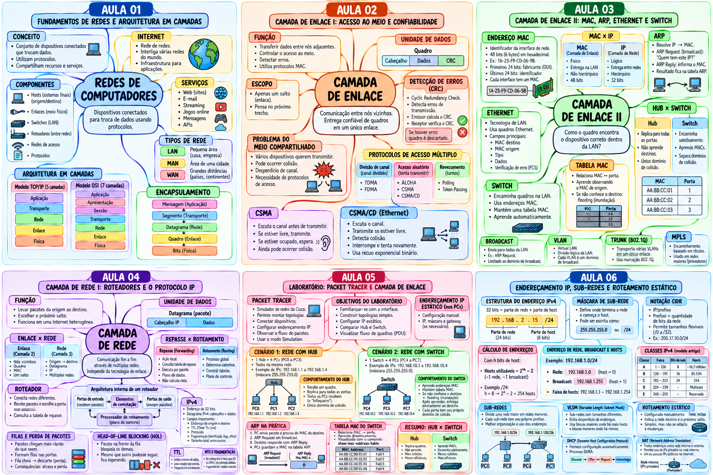

# Redes de Computadores com Cisco Packet Tracer

Repositório de estudos práticos sobre redes de computadores. Os laboratórios foram montados no Cisco Packet Tracer e documentam conceitos das camadas de enlace e de rede, endereçamento IPv4, subnetagem, roteamento e tolerância a falhas.



## Projetos

### Hub e switch na camada de enlace

Comparação do comportamento de hubs e switches durante o encaminhamento de quadros.

Conceitos praticados:

- endereços MAC e tabela MAC;
- ARP e ICMP;
- broadcast;
- domínios de colisão;
- simulação de pacotes no Packet Tracer.

Arquivos principais:

- [`Atividade.pkt`](Atividades/Atividade.pkt): cenário com hub;
- [`atividade02.pkt`](Atividades/atividade02.pkt): cenário com switch.

### Roteamento estático e RIP v2

Topologia com três LANs e três roteadores interligados em triângulo. O laboratório compara rotas configuradas manualmente com rotas aprendidas pelo RIP v2.

Conceitos praticados:

- subnetagem VLSM;
- rotas estáticas;
- RIP versão 2;
- distância administrativa e métrica por saltos;
- testes com `ping` e `tracert`;
- convergência e caminho alternativo após a falha de um enlace.

Arquivos principais:

- [`lab08_estatico.pkt`](Atividades/lab08_estatico.pkt): roteamento estático;
- [`lab08_rip.pkt`](Atividades/lab08_rip.pkt): roteamento dinâmico;
- [`relatório público`](Atividades/Relatorio_Aula_08_publico.docx): evidências e análise sem dados pessoais.

## Topologia do laboratório de roteamento

O bloco `192.168.10.0/24` foi dividido para atender três unidades:

| Segmento | Rede | Máscara | Hosts utilizáveis |
|---|---|---|---:|
| Matriz | `192.168.10.0/25` | `255.255.255.128` | 126 |
| Filial Norte | `192.168.10.128/26` | `255.255.255.192` | 62 |
| Filial Sul | `192.168.10.192/27` | `255.255.255.224` | 30 |

Os enlaces entre roteadores utilizam redes `/30`. Com RIP ativo, a remoção do enlace direto entre R1 e R2 faz o tráfego seguir pelo caminho alternativo R1–R3–R2.

## Como executar

1. Instale o Cisco Packet Tracer 9 ou uma versão compatível.
2. Abra um dos arquivos `.pkt` da pasta `Atividades`.
3. Use o modo **Realtime** para testar `ping` e `tracert`.
4. Use o modo **Simulation** para acompanhar o fluxo de pacotes.

## Organização do repositório

```text
redes_de_computadores/
├── Atividades/
│   ├── Atividade.pkt
│   ├── atividade02.pkt
│   ├── lab08_estatico.pkt
│   ├── lab08_rip.pkt
│   └── Relatorio_Aula_08_publico.docx
├── mm_redes.png
└── README.md
```

## Observação sobre os materiais de aula

Os PDFs, guias fornecidos pela instituição e relatórios com dados pessoais não fazem parte da versão pública do repositório. O projeto publica apenas arquivos produzidos durante os estudos e relatórios preparados para o portfólio.
